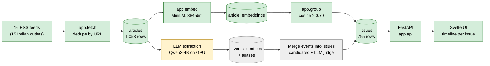
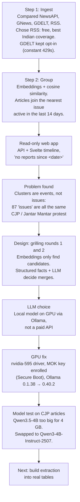
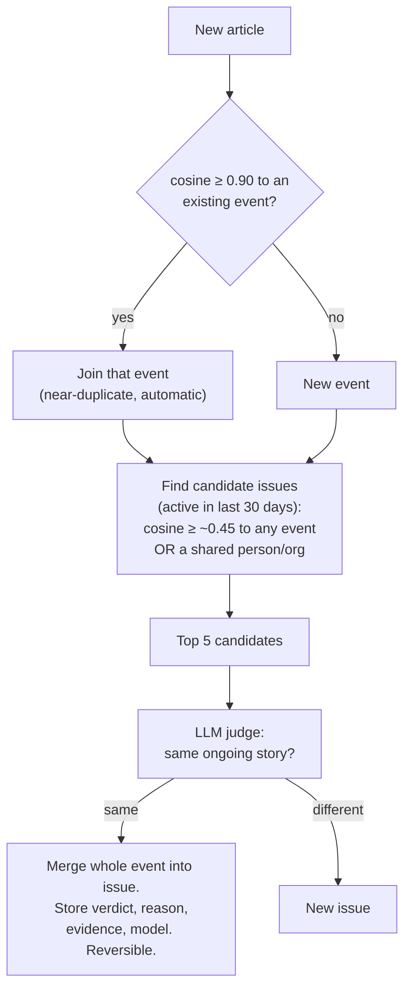
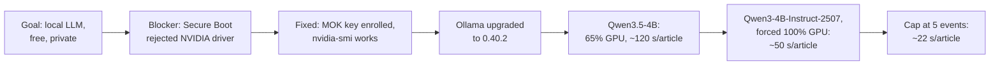

# Smriti: what has been built and decided so far

_Snapshot: 2026-10-10. For day-to-day state and commands, see `PROGRESS.md`._

Smriti remembers the news. It follows one issue over time (what happened, who acted, what is still open) and links every fact to its source article.

## 1. The whole pipeline at a glance

Green = built and working. Yellow = being tested now. Grey = designed, not built yet.

## 2. Timeline of the work

## 3. Why the design changed

Similarity alone gives clusters at the **event** level ("trains cancelled for protest"), not the **issue** level ("the CJP protest against the CEC"). One story was split into 87 issues.

New approach: embeddings only **suggest** candidates. Structured facts plus an LLM **decide**.

## 4. Decisions so far (grilling rounds 1 and 2)

| # | Question | Decision |
|---|---|---|
| 1 | When to merge automatically? | Only near-duplicates (cosine ≥ 0.90) join an event automatically. Every issue-level merge goes to the LLM. |
| 2 | What is a candidate? | Cosine ≥ ~0.45 to any event of the issue, or at least one shared key person/org. Only issues active in the last 30 days. Top 5 go to the LLM. |
| 3 | Which signals matter most? | People and orgs are strong signals. Places, action types and dates are context for the LLM, never filters. |
| 4 | Who decides? | The LLM, automatically. Verdict, reason, evidence and model are stored. Every merge can be undone. |
| 5 | Graph storage | Typed Postgres tables (`issues`, `events`, `entities`) plus link tables. No graph database. |
| 7 | Full article text? | Fetched at extraction time, given to the LLM, then discarded. Only facts, the exact quote and the URL are stored. |
| 8 | What is one issue? | The same ongoing story: same core dispute or demand, same main people/orgs, over time. A different group's protest at the same place is a different issue. |
| 9 | What does the LLM compare? | A whole event (all its articles) against an issue, one call per event. The event's articles move together. |
| 10 | Same person, different spellings? | `entities` (one row per real person/org) plus `entity_aliases` (every spelling seen). Start with exact match on normalized text. |

## 5. The LLM and GPU story

Hardware limit: GTX 1650 with 4 GB VRAM and 7.1 GB system RAM, so models above ~4B parameters don't fit.

Settings that make the model fit fully on the GPU (sent with every request): `num_ctx` 4096, `num_gpu` 99, thinking off, JSON-schema-constrained output.

## 6. Latest test result (30 CJP articles)

Command: `python -m app.llm_test`. Per-article output: `logs/llm_test_2026-10-10.jsonl`.

| Measure | Result |
|---|---|
| Full text fetched | 30 / 30 |
| Valid JSON | 24 / 24 that ran (6 failed because the Ollama service restarted mid-run, not a model fault) |
| Quotes found word for word in the article | 89 / 116 (77%) |
| Seconds per article | 22.2 |
| On GPU | 100% |

Still to check by hand: whether `who` and `what` are correct on about 10 articles.

## 7. What comes next

1. Check about 10 extracted articles by hand for field accuracy.
2. Decide what to do with quotes that are not word for word: drop the event, or keep it without a quote.
3. Add the `events`, `entities`, `entity_aliases` and link tables to `schema.sql`.
4. Build the real extraction step, then the candidate-and-judge merge.
