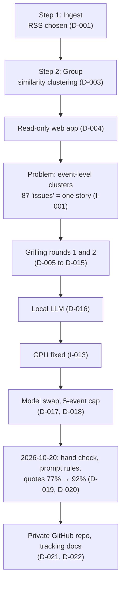

# Decisions

Every design decision, oldest first. Entries are never edited after the fact: a changed decision gets a new entry that says what it supersedes. Numbers in brackets like [G1] are the grilling-round numbers used in older notes.

| ID | Date | Decision | Supersedes |
|---|---|---|---|
| D-001 | 2026-10-10 | News source: RSS feeds. GDELT is opt-in only | |
| D-002 | 2026-10-10 | Store links and metadata only, never full text. Dedupe on normalized URL | |
| D-003 | 2026-10-10 | Group by embedding similarity (cosine ≥ 0.70, issues active 14 days) | |
| D-004 | 2026-10-10 | Frontend: Svelte + Vite, read-only, hash router | |
| D-005 | 2026-10-10 | Embeddings only find candidates; structured facts + an LLM decide merges | D-003 (as the final grouping) |
| D-006 | 2026-10-10 | Graph stays in plain Postgres tables, no graph database | |
| D-007 | 2026-10-10 | [G1] Near-duplicates (cosine ≥ 0.90) join an event automatically; every issue-level merge goes to the LLM | |
| D-008 | 2026-10-10 | [G2] Candidate issue = cosine ≥ ~0.45 to any of its events, or a shared key person/org; active in last 30 days; top 5 go to the LLM | |
| D-009 | 2026-10-10 | [G3] People/orgs are strong signals; places, action types and dates are context, never filters | |
| D-010 | 2026-10-10 | [G4] The LLM decides merges automatically; verdict, reason, evidence and model are stored; every merge is reversible | |
| D-011 | 2026-10-10 | [G5] Typed tables (`issues`, `events`, `entities`) plus link tables, not generic nodes/edges | |
| D-012 | 2026-10-10 | [G7] Full text is fetched at extraction time, given to the LLM, then discarded | |
| D-013 | 2026-10-10 | [G8] Definition of "one issue" (used in the LLM prompt) | |
| D-014 | 2026-10-10 | [G9] The LLM judges a whole event against an issue; the event's articles move together | |
| D-015 | 2026-10-10 | [G10] `entities` + `entity_aliases`, exact match on normalized alias to start | |
| D-016 | 2026-10-10 | LLM runs locally on the GPU via Ollama; model Qwen3.5-4B | |
| D-017 | 2026-10-10 | Model swapped to Qwen3-4B-Instruct-2507 (Q4_K_M) | D-016 (model only) |
| D-018 | 2026-10-10 | Extract at most 5 events per article | |
| D-019 | 2026-10-20 | Unverified quotes are dropped; the event is kept but marked unverified | |
| D-020 | 2026-10-20 | Prompt rules and action types `demand`, `warning` added | |
| D-021 | 2026-10-20 | Code is backed up to a private GitHub repo | |
| D-022 | 2026-10-20 | Project tracking: `PROGRESS` / `ISSUES` / `DECISIONS` in Markdown, diagrams in Mermaid | |
| D-023 | 2026-10-20 | **[MVP]** Story grouping is the core of the MVP: stories as a connected graph that can be traversed. Cosine alone is not a reliable judge | |
| D-024 | 2026-10-20 | **[MVP]** Grouping model: two-tower bi-encoder (retrieve) + cross-encoder transformer (link type + weight); LLM only labels, referees and explains. Model picked by a gold-set comparison | D-007, D-008, D-010, D-014 (LLM as the main judge) |
| D-025 | 2026-10-20 | **[MVP]** The grouping model groups articles (title + snippet), not extracted events; events attach to their article's story later | D-014 (event as the unit) |
| D-026 | 2026-10-20 | Backfill from GDELT GKG bulk files (Indian outlets from our feed list, English only); the GDELT search API is dropped | D-001 (GDELT part) |
| D-027 | 2026-10-20 | **[MVP]** Build the whole pipeline now with pretrained models (towers, cross-encoder, links, UI); measure and fine-tune after. Provisional cut-offs from a proxy calibration | Build order in D-024 (gold set before building) |
| D-028 | 2026-10-20 | **[MVP]** Fine-tune the cross-encoder now (teacher-student): the LLM labels ~3,000 article pairs, bge-reranker-v2-m3 learns "same story?", and grouping uses it for every candidate below near-duplicate (cosine 0.92) | D-027 (zero-shot cross-encoder and its 0.70 / 0.3 cut-offs) |
| D-029 | 2026-10-20 | Claude (Opus 5.5) labels the gold set instead of the user; never the local LLM, which taught the student | G-2 as planned: 200 pairs labelled by hand |
| D-030 | 2026-10-24 | A story's timeline becomes a path of key-moment dots ending at "now", with short AI labels checked against the headlines; prototype first | The day-by-day article list as the story view (TECHNICAL section 7) |
| D-031 | 2026-10-24 | Grouping shows the cross-encoder a story's members closest to the article; split stories merge when all 3 of their closest article pairs pass; blank titles and same-day copies are left out | D-028's "latest 3 headlines"; "assigned articles never move" (merges move them) |
| D-032 | 2026-10-25 | A front page of "Today's stories": cards ranked by outlets in the last 48 hours, AI titles, topic tabs from link sections, junk left out, twice-daily automatic fetch; prototype first, built after the regroup | The list of every story with 2 or more articles as the first page; Hindi switch (round 1, withdrawn in round 2) |
| D-033 | 2026-10-25 | Build the front page into the app now, not as a separate prototype page and not after the regroup; titles stored per newest moment with no foreign key to stories | D-032's order (prototype first, built after the regroup) |
| D-034 | 2026-10-25 | Fix I-023 now: teacher labels 1000 shared-name pairs, the student is retrained, grouping scores each closest headline separately (mean); fetch + retrain + regroup start immediately instead of 22:00 | D-031's joined-text scoring; the 22:00 run of run_2026-10-24.sh |
| D-035 | 2026-10-25 | Teach the teacher first: five hard-case rules in the label instructions (same kind/different case, same actor/different matter, new development = same story, explainers = same story, routine reports = a new story each day); all 4000 training pairs relabelled before one regroup; 50 shared-name gold pairs | Regrouping right away with the old teacher's labels (D-034's first run order) |
| D-036 | 2026-10-26 | News categories: 9 subjects (Politics, Crime & Justice, Business, Sports, Entertainment, Tech & Science, Health, Environment & Disasters, Society) as the front-page tabs, plus a separate India / World switch; the LLM labels sampled articles, a linear classifier on bge-m3 vectors labels every story | D-032's topic tabs from link sections |
| D-037 | 2026-10-26 | Simpler front-page cards: category · region, title, one "Latest" line, outlets · time; the dot path only on the lead card | D-032's card layout (status, day count, dots on every card, quoted headlines, report count) |
| D-038 | 2026-10-26 | English only for now: Hindi headlines are kept in `articles` but left out of stories; the logo is a plain "S" | |
| D-039 | 2026-11-15 | Open source under AGPL-3.0; the user keeps the copyright and can offer other licenses; outside contributions need a CLA that lets the user relicense them; the database and fine-tuned models stay out of the repo | D-021 (private repo) |
| D-040 | 2026-11-15 | Old commits that still show the Gmail address are removed by GitHub Support, not by deleting and recreating the repo | |
| D-041 | 2026-11-15 | I-016: when an article passes the join cut-off for two stories, that pair goes to the merge pass (same strict check); then more teacher pairs of editorial / review / feature against its news, retrain, full regroup. Scoring a story by its best headline instead of the mean is not done (I-023) | |
| D-042 | 2026-11-15 | Reader features next, from the Reuters Institute Digital News Report 2026 (trust 37%, 42% avoid news, people click through for detail and to check the source): a 2-line story summary, "what's new since your last visit", and source strength per moment; then follow a story | |

[G6] was never recorded in the notes; the number is skipped on purpose.

---

## Details

**D-001 · RSS as the news source.** Compared NewsAPI, GNews, GDELT and RSS. RSS is free, has no request limits, and gives the best coverage of Indian outlets (16 feeds from 15 sources in `feeds.txt`). GDELT gave persistent 429s and empty results, so it runs only with `--gdelt`.

**D-002 · Links and metadata only.** For copyright reasons, only title, URL, source, dates, language, a ≤500-character snippet and a content hash are stored. `INSERT … ON CONFLICT (url) DO NOTHING` makes fetching idempotent.

**D-003 · Similarity grouping.** fastembed `paraphrase-multilingual-MiniLM-L12-v2` on title + snippet. Articles join the nearest issue centroid active in the last 14 days, oldest first, and never move.

**D-004 · Svelte frontend.** The lightest option that still gives a proper timeline view. Read-only for now.

**D-005 · Embeddings only find candidates.** At 0.70, clusters came out at the event level ("trains cancelled for protest"), not the issue level: 87 separate "issues" were all the CJP / Jantar Mantar protest. See I-001.

**D-006 · Plain Postgres for the graph.** One database to run and back up; the graph is small enough for relation tables.

**D-007 to D-010 · Merge rules.** Near-duplicates are safe to merge without asking. Everything else is a judgment call, so the LLM decides, and every decision is stored with its evidence so it can be reviewed and undone (a review page comes later). People and orgs are the most reliable sign that two events belong to the same story; places and dates are too common to filter on.

**D-011 · Typed tables.** Clearer queries and real foreign keys, rather than a generic nodes/edges table.

**D-012 · Full text only in memory.** Extraction needs the full article, but storing it would break D-002. Only extracted facts, the exact quote and the source URL are kept.

**D-013 · What "one issue" means.** The same ongoing story, with the same core dispute or demand and the same main people/orgs, followed over time. Example: CJP demand → Jantar Mantar protest → detentions → trains cancelled → government response is one issue. A different group's protest at the same place is a different issue.

**D-014 · Judge events, not articles.** One LLM call per event keeps the number of calls down and keeps related articles together.

**D-015 · Entities and aliases.** One row per real person/org with one canonical name, plus every spelling seen ("Abhijit" / "Abhijeet" Dipke). Fuzzy or LLM matching only if duplicates show up.

**D-016 · Local LLM.** Free and private, no API costs. Run with thinking off and JSON-schema-constrained output (Ollama `format`). Needed the GPU fixes in I-013.

**D-017 · Qwen3-4B-Instruct-2507.** Qwen3.5-4B only fit 65% on the 4 GB GPU (~10 tok/s, ~120 s/article) and ran out of memory when forced fully onto it (I-014). Qwen3-4B-Instruct-2507 with `num_ctx` 4096 and `num_gpu` 99 runs 100% on GPU at ~38 tok/s.

**D-018 · Five events per article.** Output length is the main cost. Capping at 5 took a real article from ~50 s to ~22 s; minor events were mostly noise.

**D-019 · Unverified quotes.** A quote is verified if every piece of it (split at `…` and `[editorial brackets]`) appears in the article text. If not, the real extraction drops the quote and marks the event unverified; unverified events are not used as merge evidence. Dropping the whole event would lose real facts whose quote was merely reworded. See I-006.

**D-020 · Prompt rules.** From the hand check of 10 articles on 2026-10-20: no "could / may" events unless someone said them (then `statement` or `warning`); each event once; `who` holds names exactly as written, no expanded acronyms or descriptions; a quote is one real sentence, never combined. Added `demand` and `warning`, because demands are the core of protest stories. See I-002 to I-005.

**D-021 · Private GitHub repo.** https://github.com/joybratasarkar/smriti, private. `/handoff` pushes at the end of each session so the backup stays current.

**D-022 · How we track the project.** Root: `README.md` (what it is), `CLAUDE.md` (rules), `PROGRESS.md` (where we stand now). `docs/`: `ISSUES.md`, `DECISIONS.md`, `WORKFLOW.md`, `TECHNICAL.md`. Issues are Markdown, not GitHub Issues, so they change in the same commit as the code. Diagrams are Mermaid, which GitHub renders. `ISSUES.md` is updated with each fix or finding; `/handoff` checks everything at session end; `/status` reads it back.

**D-023 · [MVP] Grouping is the MVP.** The user's words (2026-10-20): "grouping is important, like a graph and it will connected and traverse, stories are always connects same in news ... this is the mvp of the product." Measured the same day: same-story CJP pairs have median cosine 0.38 and can be as low as −0.14, while unrelated pairs reach 0.43 at the 95th percentile, so no cosine threshold separates them. Design of the better judge is being grilled; see I-001.

**D-024 · [MVP] Grouping model.** Follows the published pattern for news story discovery and event linking (USTORY / SCStory, multilingual event linking, NVIDIA NeMo retrieval recipe). Stage 1, two towers: one encoder embeds articles and stories separately, fine-tuned contrastively so cosine reflects the story, not the wording; pgvector returns the top 10 candidate stories. Stage 2, cross-encoder: reads article + story together (self-attention across both texts) and outputs a link type (`same_story`, `follow_up`, `same_actor`, `same_topic`, `unrelated`) with a calibrated probability that becomes the edge weight. Best ≥ cutoff joins the story, otherwise a new story; uncertain cases go to the LLM. The local LLM judge (D-017) labels training pairs, referees uncertain cases and writes the "why linked" text, because at 22 s per call it cannot judge every pair. Candidates: BGE pair (`bge-m3` + `bge-reranker-v2-m3`, 568M, multilingual, MIT / Apache-2.0) and NVIDIA pair (`llama-nemotron-embed-1b-v2` + `llama-nemotron-rerank-1b-v2`, ~1B, OpenMDW-1.1 + Llama 3.2 license; both allow commercial use); both fine-tuned with LoRA to fit the 4 GB GPU. The winner is chosen on a hand-labelled gold set of ~200 pairs, against cosine and a TF-IDF baseline. Rejected: NV-Embed-v2 (7.85B, non-commercial), Megatron-LM (multi-GPU training framework), a custom model from scratch (no data), a GNN (later, only if pair links miss things).

**D-025 · [MVP] Group articles, not events.** Every article already has a title and snippet, so the model can run on the whole archive in minutes. Events need LLM extraction first (22 s per article, and it was crashing, I-007). One article can cover two stories; we accept that for now.

**D-026 · GDELT bulk files for backfill.** The stories in 7 days of RSS are too short to train on, and RSS has no history. The GDELT search API returns HTTP 429 even on the first request. The GKG bulk files have no rate limit and include page titles. Cost: about 4 MB per 15 minutes, so about 24 GB to download for 60 days, giving about 2,000–3,000 articles a day from our Indian outlets. Titles only, no snippet.

**D-027 · [MVP] Pipeline first, zero-shot.** The user wants the model and the graph running now, not after the gold set. So `app.embed` (bge-m3), `app.group` (towers + cross-encoder), `app.links` (weighted, LLM-named edges) and the UI run on the pretrained models; the gold set (G-2/G-3) then measures them and fine-tuning (G-4/G-5) improves them without changing the code. Calibration on 200 CJP-protest pairs (same story) against 200 random same-day pairs: AUC bge-m3 cosine 0.893, bge-reranker-v2-m3 0.900, llama-nemotron-rerank-1b-v2 0.857, so BGE stays. The zero-shot cross-encoder is badly scaled for "same story" (median 0.01 article vs article; 0.12 article vs a story's 3 headlines). On the GTX 1650 float16 is about 5x slower than float32, so the BGE models run in float32, and the cross-encoder costs ~0.1 s per article for 3 candidates. Rule: cosine to the story centroid ≥ 0.70 joins (0.65 merged two different stories in a smoke test), < 0.40 starts a new story, in between the cross-encoder decides at ≥ 0.3 over the top 3 candidates. Links: cross-encoder on both stories' headlines, kept at weight ≥ 0.2; the LLM names the strongest. The old MiniLM vectors and cosine issues were dropped (derived data). Caveat: the proxy positives share the word "CJP" and random pairs are easy negatives, so real precision is unknown until the gold set.

**D-028 · [MVP] Fine-tune the cross-encoder now.** The user asked for the fine-tuning that fixes the zero-shot problem (D-027: the cross-encoder scores same-story pairs near 0). Teacher: the local LLM (`app/judge.py`, the gold-set rules) labels ~3,000 pairs (`app/teach.py`, table `train_pairs`, never a gold pair). Student: `bge-reranker-v2-m3`, top 4 layers and head trained in float32 on "same_story or not", 10% held out (`app/train.py`); it is only saved if it beats the zero-shot model on the held-out pairs. Sampling lesson: random similar pairs are almost never the same story (0 of 20), so a "nearest" stratum was added (an article and its most similar article within 3 days: 3 of 8 same story), also to the gold set. The teacher labels look-alike columns (horoscopes, quote of the day, cosine 0.90) as same_topic, so only near-duplicates (≥ 0.92) skip the cross-encoder now; join at P ≥ 0.5. Links keep the zero-shot cross-encoder (relatedness, not same story). Caveat: the teacher is not yet measured against people; the gold set does that (G-3).

**D-029 · Gold labels by Claude.** Labelling 200 pairs by hand takes about an hour, and the user asked for a model to do it (first the local LLM, then Claude). Not the local LLM: it is the teacher the student learned from (D-028), so its labels would only measure how well the student copies it, and the LLM would score itself perfectly. Claude labelled the 196 open pairs by the same rules (`MEANINGS` in `app/gold.py`), seeing what the labelling screen shows (dates, sources, titles, snippets), not the cosine or the stratum. The user had labelled 4. Claude's labels and reasons are in `logs/gold_claude_2026-10-20.jsonl` (local, `logs/` is not in git). The gold set is now a strong model's judgement, not a person's; the user can spot-check it. On the user's 4 pairs Claude would have differed twice (it would call an IPO's allotment and listing `same_story`, and two separate SUV crashes `same_topic`), so the user reads the rules more strictly.

**D-030 · The story timeline as a path of dots.** The user found the day-by-day list too dense (a row for every day and every report was too much information) and wants something anyone, young or old, can follow at a glance: like dots in a game: click one and it expands to show the connection, ending with the latest status. Settled in a design interview (2026-10-24):
- **Dots:** one per key moment, on a winding path from the first report to "now"; bigger dot, more news; tap a dot to read its real headlines, which open the articles. Left to right on wide screens, winding downward on narrow ones; web first, every screen size.
- **Key moments:** start from one per day and merge the most alike neighbouring moments (penalised for quiet days between them and for size) until at most 7 remain. A gap-only rule was tried and failed: news comes almost every day, so the Nepal story became one dot. Stories with fewer than 4 articles show a plain list.
- **Labels:** 4 to 7 plain words written by the local LLM from that moment's own headlines; every name and number must appear in those headlines, or the dot falls back to the trimmed real headline. In the prototype 49 of 52 labels passed.
- **End of the path:** "now": the latest report and the date the news was last checked ("Latest report 16 Oct · news checked up to 20 Oct", fixing I-021 on this page). A "what's at stake" line comes later with event extraction (Step 3).
- **Connections:** linked stories are small side dots off the path, named in plain words ("same event", "related"), replacing the "Connected stories" box; tapping one opens that story's path.
- **Reading rules:** big dots and text, no technical words, one dot open at a time, tap and keyboard both work, colour never the only signal; copies of one headline shown once with "+N more copies".
- **Prototype first:** a clickable page with three real stories (CJP protest, Nepal floods, Tiger Shroff shooting) and their linked stories, before the Svelte app changes.

**D-031 · Trust fixes: closest members, merging splits, no junk.** The user asked for the trust fixes before any more UI work (2026-10-24), after the review found that a customer would first notice one event as several stories, duplicates and junk. In `app/group.py`:
- **Closest members:** the cross-encoder reads the article with each candidate story's 3 member headlines closest to it (the article-against-article kind of pair it was trained on), not the story's 3 latest headlines. The replay of the Nepal split showed why: the latest headlines gave 0.404, the matching headline 0.96 (I-016).
- **Merge pass** after grouping: stories with 2 or more articles whose centres have cosine ≥ 0.88 and are at most 30 days apart are compared on their 3 closest article pairs; they merge into the older story when the cross-encoder gives every one of the three ≥ 0.5. A rule on the mean merged 364 stories in a dry run (2026-10-24) and joined six separate BJP-vs-Rahul-Gandhi spats; the rule on all three merged 298 and still joins those six (a same-people weakness, I-018). Merged articles move, so "assigned articles never move" no longer holds for merges.
- **Left out of grouping:** articles with a blank title (I-017) and second copies of an article, meaning the same site, headline and snippet within a day (I-019). `app/fetch.py` also stops storing both from now on.
- First applied in the overnight run of 2026-10-24 (`logs/run_2026-10-24.sh`), then measured on the gold set against the stories' recall before the fix (0.67).

**D-042 · Reader features from what news readers need.** The user asked what readers in this sector need today (2026-11-15). The Reuters Institute Digital News Report 2026 (about 100,000 people, 48 markets): trust in news 37%, the lowest since 2015; 42% avoid news sometimes or often; "casual" users up from 16% to 25% since 2021; the main reason to click through is more detail, and AI chatbot users most want follow-up questions (42%) and to check the source; 62% worry about fake news online. Smriti's job (follow a story, every fact linked to its source) fits. Order agreed: (A) a 2-line story summary, checked against the headlines like the titles; (B) "what's new since your last visit", kept in the browser, no account; (C) source strength on each moment ("reported by 12 outlets", "only one outlet"); then (D) follow a story, which needs story ids that survive merges.

**D-041 · Two fixes for split stories (I-016).** A replay of the 18 split gold pairs (2026-11-15) found three failures: a parallel story won (4), the cross-encoder said no (7), the right story was not among the 3 closest centres (7, and the cross-encoder says no to those too). The user agreed to (1) send a story pair to the merge pass when one article passes the 0.5 cut-off for both, with the same strict check (every one of the 3 closest article pairs ≥ 0.5), and (2) more teacher pairs of an editorial, review or feature against the news it is about, then retrain and regroup. Scoring a story by its best headline instead of the mean would fix 5 more pairs but bring back I-023.

**D-040 · GitHub Support clears the old commits.** After the email rewrite and force-push (D-039), GitHub still served the old commits by their ids (`5978700` showed the Gmail address, linked to the `joybratasarkar` account). The user chose to keep the repo and ask GitHub Support to remove the cached views and dangling commits, over deleting and recreating it, which is faster but loses the repo's settings and history on GitHub. Done when the old commit ids return 404.

**D-039 · Open source, rights kept.** The user wants to open-source the repo with the rights kept by them (2026-11-15). The user is the only author (all commits), so they hold the copyright. AGPL-3.0 was chosen over MIT/Apache (anyone could ship it closed) and noncommercial licenses (not OSI open source): forks run as a website must publish their changes, while the user can still sell other licenses. A CLA in `CONTRIBUTING.md` lets the user relicense outside contributions (a DCO would not). `SECURITY.md` says the API has no login and must stay local. The database (publishers' titles and snippets) and `models/` stay out of the repo. Checked before publishing: no secrets in git history, `.env` never committed. Before publishing, the user's chat messages quoted in older entries (D-027 to D-038) were reworded or dropped, and a private Claude artifact link removed; this is the one exception to the never-edit rule. Left to the user: confirm the copyright name, check their employment contract for an IP clause, enable private vulnerability reporting, then make the repo public.

**D-038 · English only for now.** The user found the app mixing English and Hindi (2026-10-26) and chose English only. The only Hindi on screen was the logo's स् and 110 Devanagari headlines (90 from BBC Hindi, 20 from India Today) inside 82 stories. `app.group` now leaves headlines with Devanagari letters out (like blank titles) and takes ones grouped earlier out of their stories at the start of each run (29 stories that held only Hindi were deleted). The rows stay in `articles`, so a Hindi edition can come later (D-032 already called Hindi sources a later step).

**D-037 · Simpler front-page cards.** The user found the front page too dense (2026-10-26). Each card had six rows. Now: category · region (and "New"), the title, one "Latest" line, "N outlets · time ago". The dot path stays on the lead card and on the story page.

**D-036 · News categories.** The user asked for news categories as a priority (2026-10-26). The old tabs came from link sections, so "India" held 303 of 556 front-page stories and Sports never showed. The user chose 9 subjects plus a separate India / World switch. Teacher and student as for grouping: the local LLM labels 1500 articles (one per story, kept per article so labels survive a regroup), a softmax regression on their bge-m3 vectors labels every story's centroid in seconds, rerun after each `app.group`. Teacher prompt chosen on 80 articles labelled by Claude: 71 right with plain category descriptions, 69 to 70 with a list of hard-case rules (the 4B model over-applied them), 74 when it first says in a few words what the article is about. Sports stays weak at the teacher (honours and rewards for athletes go to Society).

**D-035 · Teach the teacher first.** On the gold set the teacher LLM (label-only, as it labels training pairs) was wrong on 17 of 199 pairs, in four patterns: the same kind of incident in a different case joined (two different wife murders, two Delhi HC rulings), the same person or organisation in a different matter joined (two lawsuits against the Trump administration), explainers and reviews of one event split from its news (Nepal glacier flood, the novel *Da*), and routine repeating reports (forex reserves, gold prices). The student copies these. The user chose to hold the regroup until the teacher is fixed (one regroup, not two) and that **routine repeating reports are a new story each day or edition; one company's IPO from opening to listing is one story** (2026-10-25). `HARD_CASES` in `app/gold.py` holds the rules, with made-up examples so the gold set stays an honest test; `app/judge.py` adds them to the teacher's instructions and the terminal labeller shows them. A fifth rule was added after the first try: "a new development in the same dispute is same_story, not follow_up" (the teacher had moved 3 same-story pairs to follow_up). Teacher on the original 199 gold pairs: 91.5% → 94.5% (recall 0.85 → 0.90, precision 0.80 → 0.83); on 49 new shared-name gold pairs 87.8% (labelled by Claude, D-029; `logs/gold_claude_2026-10-25.jsonl`). The Tempsens IPO gold pair was relabelled same_story by the user's rule. Old training labels are kept in `train_pairs_before_d035`. Left: the 4B teacher still joins some same-actor and same-kind pairs; a stronger teacher would cost API money (D-016 chose local).

**D-034 · Teach the student "same person is not same story" (I-023).** The user saw the Tiger Shroff shooting and Tukaram Mundhe's FDA notices in one timeline and asked to fix grouping and start fetching and regrouping right away (2026-10-25). The teacher LLM already labels these pairs right, so the student gets 1000 new teacher-labelled pairs that share a rare capitalised title word (`python -m app.teach --names 1000 --label`), then `app.train` retrains it on all labelled pairs. `app.group` now scores the article against each of a story's 3 closest headlines on its own (as in training) and joins on their mean, instead of one joined text. Raising the cut-off was rejected: on the gold set JOIN 0.7 drops recall from 0.81 to 0.69. The news since 2026-10-20 was fetched first (GDELT 6,494 new, RSS 6); the run was then held for D-035 and restarted as `logs/run_2026-10-25.sh` (relabel, train, gold score of the student, embed, group --reset, links, link names, labels, front titles, gold check; `logs/run3.done`).

**D-033 · The front page goes into the app now.** After seeing the prototype page (a private Claude artifact) the user asked for it in the codebase instead (2026-10-25). Built as `app/front.py` (`GET /api/front`, `python -m app.front --titles N`) and `FrontPage.svelte` / `StoryCard.svelte`; `#/all` is the old list ("All stories"), where the top bar's search lands. Titles live in `story_titles`, keyed by the newest moment's articles like `moment_labels`, with no foreign key to `issues`: `app.group --reset` truncates `issues`, and a foreign key would have broken the 22:00 regroup. Story ids change after the regroup; the page reads them live, so only `--titles` needs rerunning. The automatic twice-daily fetch of D-032 is not built yet.

**D-032 · A front page of "Today's stories".** The UI/UX review (2026-10-24) found the first page, a list of 14,782 stories by size, is not something a reader can start from. Settled in a three-round design interview (2026-10-25, the user answered "yes to all" each round):
- **What it shows:** the stories most reported in the last 48 hours of checked news, ranked by the number of different outlets (so one site posting 30 updates cannot push a story up), then by reports. One large lead card with its mini dot-path, then 12 cards in a grid (3 columns on desktop, 2 on tablet, 1 on phone) and "Show more" for the next 12.
- **A card:** a clean title, a mini dot-path without labels (dot size = how much was reported, a pulsing "now" dot), the report count, "Latest:" with the AI label of the newest dot (or its trimmed headline), a "New" or "Developing · day N" tag, and when it was updated. Tapping the card opens the story page at "now"; the card's dots are not separate targets.
- **AI titles:** 5 to 9 plain words written by the local LLM from the story's main headlines, with the dot labels' safety check (every name and number must appear in a headline), else the trimmed headline. Written in the pipeline after grouping for the front-page stories (about 50 a day), stored, and rewritten only when the story gets a new newest dot.
- **Topic tabs:** India, World, Business, Sports, Entertainment, Tech and More. A story's topic is the most common link section among its articles (`/world/`, `/business/`, ...); about 30% of links only say `/news/` or `/article/`, so stories without a known section go under More. Tabs with fewer than 3 stories are hidden. LLM topics only if the link sections are not good enough.
- **Left out:** stories with fewer than 4 reports and repeating columns, by link section (`/astrology/`, `/brandhub/` paid content, `/trending/`) and by title (horoscope, quote of the day, "Sensex today", "gold rate today"). Search still finds them.
- **Top bar:** "Smriti · news that remembers", the topic tabs, a search box, and "checked HH:MM", which turns amber ("news may be out of date") when the last fetch is more than 24 hours old. The current list of all stories becomes the "All stories" results page.
- **Language:** English only for now. A Hindi switch was accepted in round 1 and withdrawn in round 2 because only 66 of 138,229 articles are Hindi; Hindi sources are a later step.
- **Automatic fetch:** RSS plus the last day of GDELT (about 400 MB a day) at 07:00 and 19:00, then embed, group and link the new articles, as a systemd user timer that catches up after the laptop wakes. Each run takes a lock and skips ("skipped: busy") if another pipeline job holds it, because the GPU fits one model at a time.
- **Order:** a clickable prototype with real stories from 19–20 October first; built into the app after the regroup of D-031 is checked, because it changes story ids and splits.

---

## Timeline

