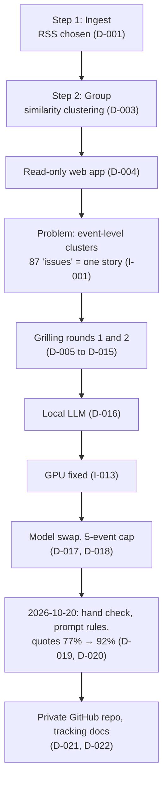

# Decisions

Every design decision, oldest first. Entries are never edited after the fact: a changed decision gets a new entry that says what it supersedes. Numbers in brackets like [G1] are the grilling-round numbers used in older notes.

| ID | Date | Decision | Supersedes |
|---|---|---|---|
| D-001 | 2026-10-10 | News source: RSS feeds. GDELT is opt-in only | |
| D-002 | 2026-10-10 | Store links and metadata only, never full text. Dedupe on normalized URL | |
| D-003 | 2026-10-10 | Group by embedding similarity (cosine ≥ 0.70, issues active 14 days) | |
| D-004 | 2026-10-10 | Frontend: Svelte + Vite, read-only, hash router | |
| D-005 | 2026-10-10 | Embeddings only find candidates; structured facts + an LLM decide merges | D-003 (as the final grouping) |
| D-006 | 2026-10-10 | Graph stays in plain Postgres tables, no graph database | |
| D-007 | 2026-10-10 | [G1] Near-duplicates (cosine ≥ 0.90) join an event automatically; every issue-level merge goes to the LLM | |
| D-008 | 2026-10-10 | [G2] Candidate issue = cosine ≥ ~0.45 to any of its events, or a shared key person/org; active in last 30 days; top 5 go to the LLM | |
| D-009 | 2026-10-10 | [G3] People/orgs are strong signals; places, action types and dates are context, never filters | |
| D-010 | 2026-10-10 | [G4] The LLM decides merges automatically; verdict, reason, evidence and model are stored; every merge is reversible | |
| D-011 | 2026-10-10 | [G5] Typed tables (`issues`, `events`, `entities`) plus link tables, not generic nodes/edges | |
| D-012 | 2026-10-10 | [G7] Full text is fetched at extraction time, given to the LLM, then discarded | |
| D-013 | 2026-10-10 | [G8] Definition of "one issue" (used in the LLM prompt) | |
| D-014 | 2026-10-10 | [G9] The LLM judges a whole event against an issue; the event's articles move together | |
| D-015 | 2026-10-10 | [G10] `entities` + `entity_aliases`, exact match on normalized alias to start | |
| D-016 | 2026-10-10 | LLM runs locally on the GPU via Ollama; model Qwen3.5-4B | |
| D-017 | 2026-10-10 | Model swapped to Qwen3-4B-Instruct-2507 (Q4_K_M) | D-016 (model only) |
| D-018 | 2026-10-10 | Extract at most 5 events per article | |
| D-019 | 2026-10-20 | Unverified quotes are dropped; the event is kept but marked unverified | |
| D-020 | 2026-10-20 | Prompt rules and action types `demand`, `warning` added | |
| D-021 | 2026-10-20 | Code is backed up to a private GitHub repo | |
| D-022 | 2026-10-20 | Project tracking: `PROGRESS` / `ISSUES` / `DECISIONS` in Markdown, diagrams in Mermaid | |

[G6] was never recorded in the notes; the number is skipped on purpose.

---

## Details

**D-001 · RSS as the news source.** Compared NewsAPI, GNews, GDELT and RSS. RSS is free, has no request limits, and gives the best coverage of Indian outlets (16 feeds from 15 sources in `feeds.txt`). GDELT gave persistent 429s and empty results, so it runs only with `--gdelt`.

**D-002 · Links and metadata only.** For copyright reasons, only title, URL, source, dates, language, a ≤500-character snippet and a content hash are stored. `INSERT … ON CONFLICT (url) DO NOTHING` makes fetching idempotent.

**D-003 · Similarity grouping.** fastembed `paraphrase-multilingual-MiniLM-L12-v2` on title + snippet. Articles join the nearest issue centroid active in the last 14 days, oldest first, and never move.

**D-004 · Svelte frontend.** The lightest option that still gives a proper timeline view. Read-only for now.

**D-005 · Embeddings only find candidates.** At 0.70, clusters came out at the event level ("trains cancelled for protest"), not the issue level: 87 separate "issues" were all the CJP / Jantar Mantar protest. See I-001.

**D-006 · Plain Postgres for the graph.** One database to run and back up; the graph is small enough for relation tables.

**D-007 to D-010 · Merge rules.** Near-duplicates are safe to merge without asking. Everything else is a judgment call, so the LLM decides, and every decision is stored with its evidence so it can be reviewed and undone (a review page comes later). People and orgs are the most reliable sign that two events belong to the same story; places and dates are too common to filter on.

**D-011 · Typed tables.** Clearer queries and real foreign keys, rather than a generic nodes/edges table.

**D-012 · Full text only in memory.** Extraction needs the full article, but storing it would break D-002. Only extracted facts, the exact quote and the source URL are kept.

**D-013 · What "one issue" means.** The same ongoing story, with the same core dispute or demand and the same main people/orgs, followed over time. Example: CJP demand → Jantar Mantar protest → detentions → trains cancelled → government response is one issue. A different group's protest at the same place is a different issue.

**D-014 · Judge events, not articles.** One LLM call per event keeps the number of calls down and keeps related articles together.

**D-015 · Entities and aliases.** One row per real person/org with one canonical name, plus every spelling seen ("Abhijit" / "Abhijeet" Dipke). Fuzzy or LLM matching only if duplicates show up.

**D-016 · Local LLM.** Free and private, no API costs. Run with thinking off and JSON-schema-constrained output (Ollama `format`). Needed the GPU fixes in I-013.

**D-017 · Qwen3-4B-Instruct-2507.** Qwen3.5-4B only fit 65% on the 4 GB GPU (~10 tok/s, ~120 s/article) and ran out of memory when forced fully onto it (I-014). Qwen3-4B-Instruct-2507 with `num_ctx` 4096 and `num_gpu` 99 runs 100% on GPU at ~38 tok/s.

**D-018 · Five events per article.** Output length is the main cost. Capping at 5 took a real article from ~50 s to ~22 s; minor events were mostly noise.

**D-019 · Unverified quotes.** A quote is verified if every piece of it (split at `…` and `[editorial brackets]`) appears in the article text. If not, the real extraction drops the quote and marks the event unverified; unverified events are not used as merge evidence. Dropping the whole event would lose real facts whose quote was merely reworded. See I-006.

**D-020 · Prompt rules.** From the hand check of 10 articles on 2026-10-20: no "could / may" events unless someone said them (then `statement` or `warning`); each event once; `who` holds names exactly as written, no expanded acronyms or descriptions; a quote is one real sentence, never combined. Added `demand` and `warning`, because demands are the core of protest stories. See I-002 to I-005.

**D-021 · Private GitHub repo.** https://github.com/joybratasarkar/smriti, private. `/handoff` pushes at the end of each session so the backup stays current.

**D-022 · How we track the project.** Root: `README.md` (what it is), `CLAUDE.md` (rules), `PROGRESS.md` (where we stand now). `docs/`: `ISSUES.md`, `DECISIONS.md`, `WORKFLOW.md`, `TECHNICAL.md`. Issues are Markdown, not GitHub Issues, so they change in the same commit as the code. Diagrams are Mermaid, which GitHub renders. `ISSUES.md` is updated with each fix or finding; `/handoff` checks everything at session end; `/status` reads it back.

---

## Timeline

