# Smriti: diagrams

_Last updated: 2026-10-20._ Where we stand in words: [`PROGRESS.md`](../PROGRESS.md). Problems: [`ISSUES.md`](ISSUES.md). Why things are the way they are: [`DECISIONS.md`](DECISIONS.md).

How the story model works, in reading order: grouping (section 3), the transformer inside it (section 4), how it learned (section 5), links and the graph (section 6). The decisions behind it: section 7.

## 1. Pipeline

Green = built. Yellow = testing or running. Grey = designed, not built. Red = blocked.

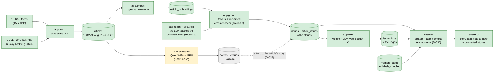

Run on all 60 days (2026-10-20, `logs/full_run.sh`): 72,591 stories and 10,390 links. Numbers in [`PROGRESS.md`](../PROGRESS.md); what is still wrong in section 2.

## 2. Issue board

IDs link to [`ISSUES.md`](ISSUES.md). P1 issues are marked with ★.

```mermaid
flowchart LR
    subgraph OPEN["Open"]
        direction TB
        I016["★ I-016<br/>one event, parallel stories"]
        I017["I-017<br/>blank titles, junk story"]
        I018["I-018<br/>similar incidents chain"]
        I019["I-019<br/>same article twice"]
        I005["I-005<br/>duplicate events"]
        I011["I-011<br/>old NVIDIA package"]
        I012["I-012<br/>git credential warning"]
    end
    subgraph PROG["In progress"]
        direction TB
        I001["★ I-001<br/>event vs issue clusters"]
        I002["★ I-002<br/>who errors"]
        I003["I-003<br/>action_type"]
        I004["I-004<br/>speculation as fact"]
        I015["I-015<br/>daily columns chain"]
    end
    subgraph BLOCK["Blocked"]
        direction TB
        NONE["(none)"]
    end
    subgraph DONE["Closed"]
        direction TB
        I006["I-006 quotes"]
        I007["I-007 Ollama OOM-killed"]
        I020["I-020 outlet names"]
        I021["I-021 stale 'no reports'"]
        I008["I-008 TECHNICAL.md"]
        I009["I-009 data stale"]
        I010["I-010 GDELT (won't fix)"]
        I013["I-013 Secure Boot"]
        I014["I-014 model too big"]
    end
    OPEN ~~~ PROG ~~~ BLOCK ~~~ DONE

    classDef p1 fill:#f8d7da,stroke:#c62828,color:#000
    classDef normal fill:#fff,stroke:#888,color:#000
    classDef closed fill:#d4edda,stroke:#2e7d32,color:#000
    class I016,I001,I002 p1
    class I017,I018,I019,I005,I011,I012,I003,I004,I015,NONE normal
    class I006,I007,I008,I009,I010,I013,I014,I020,I021 closed
```

## 3. How an article joins a story (built, D-024 and D-028)

`app.group` takes every article once, oldest first. An assigned article never moves, so story ids stay stable. The cut-offs (0.40, 0.92, 0.5) are provisional until the gold set measures them (D-027).

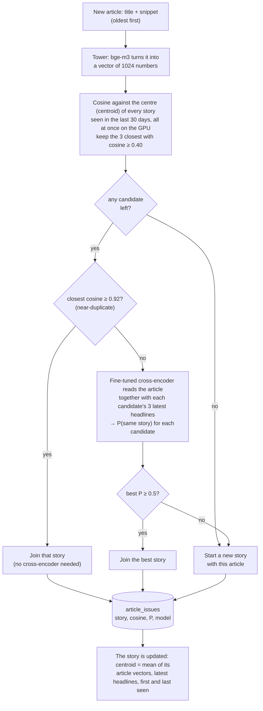

- **Why two models:** the tower turns each text into a vector on its own, so one article is compared with every story centre in a single GPU step, but cosine only measures how alike two texts look. The cross-encoder reads the article and the story together, so it can tell two horoscopes (same topic) from two reports of the same flood (same story). It costs about 0.1 s per article, so it only sees the 3 candidates.
- **What gets stored:** `article_issues` keeps each article's story, the tower cosine, and the cross-encoder probability and model (empty when the towers decided alone). A story's timeline is its articles by date.
- **Known problems:** one event can still split into parallel stories (I-016); the daily-column chains (I-015) look fixed by the fine-tuned model.

## 4. Inside the transformer

Both models are the same kind of transformer (XLM-RoBERTa-large). The difference is what goes in and what comes out.

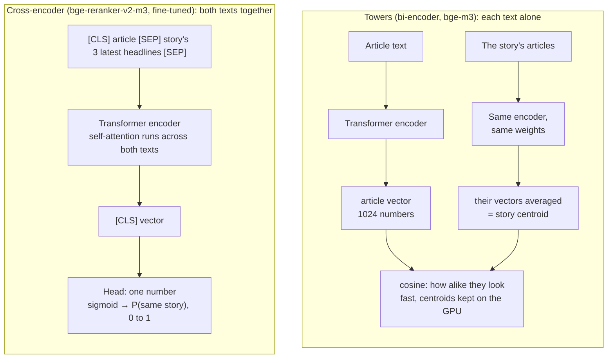

What happens inside one encoder (numbers for `bge-m3` / `bge-reranker-v2-m3`, XLM-RoBERTa-large):

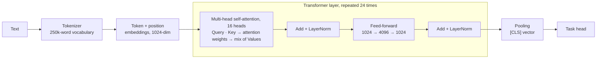

- **Self-attention:** every token looks at every other token, left and right. In the cross-encoder, "trains cancelled" in the article can attend to "CJP protest" in the story; with cosine the two texts never see each other.
- **Fine-tuning (D-028):** only the cross-encoder's top 4 layers (21 to 24) and its head were trained, on the teacher's labels (section 5), with binary cross-entropy: same story or not. Layers 1 to 20 stay frozen, which keeps training inside the 4 GB GPU (about 10 minutes for 3,000 pairs). The towers are used as downloaded.
- **Same model, two jobs:** grouping uses the fine-tuned cross-encoder ("same story?"). Links use the original, zero-shot one, because a link can be any connection, not only the same story (section 6).

## 5. How the model gets built (G-1 to G-7)

The LLM is too slow to judge every article, so it teaches the cross-encoder instead (teacher-student, D-028): it labels pairs once, offline, with the gold-set rules, and the cross-encoder learns to copy it.

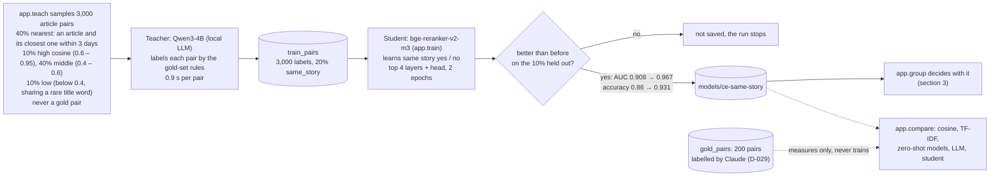

The held-out check compares the student with the teacher's labels: it shows the student copies the teacher well, not that the teacher is right. The gold set is the real test (G-3). Claude labelled it, not the teacher, so the test stays independent of what the student learned (D-029). Retraining reuses the stored labels: the LLM only labels new pairs, and the student is trained again from the original model on all of them.

The build order changed (D-027, D-028): the pipeline and the fine-tuning came first; the gold set now measures them.

```mermaid
flowchart LR
    G1["G-1 Backfill<br/>GDELT, 60 days"] --> G4["G-4 Teacher labels<br/>LLM labels 3,000 pairs"]
    G4 --> G5["G-5 Fine-tune<br/>cross-encoder, top 4 layers"]
    G5 --> G6["G-6 Graph tables<br/>model groups + links"]
    G6 --> G7["G-7 UI<br/>timeline + connected stories"]
    G7 --> G2["G-2 Gold set<br/>200 pairs, labelled<br/>by Claude (D-029)"]
    G2 --> G3["G-3 Compare<br/>every model on the gold set"]
    G3 --> CHK{"student beats<br/>the baselines?"}
    CHK -- "no" --> G4
    CHK -- "yes: AUC 0.966,<br/>cosine 0.918" --> CUT["Set the cut-offs on the gold set<br/>student's best 0.485: keep 0.5"]

    classDef done fill:#d4edda,stroke:#2e7d32,color:#000
    classDef testing fill:#fff3cd,stroke:#b8860b,color:#000
    classDef planned fill:#eeeeee,stroke:#888,color:#000
    class G1,G4,G5,G6,G7,G2,G3,CHK done
    class CUT testing
```

## 6. Links and the graph in Postgres (built, G-6)

Stories are the nodes, `issue_links` rows are the edges (D-006, D-011, D-024). `app.links` runs after `app.group`:

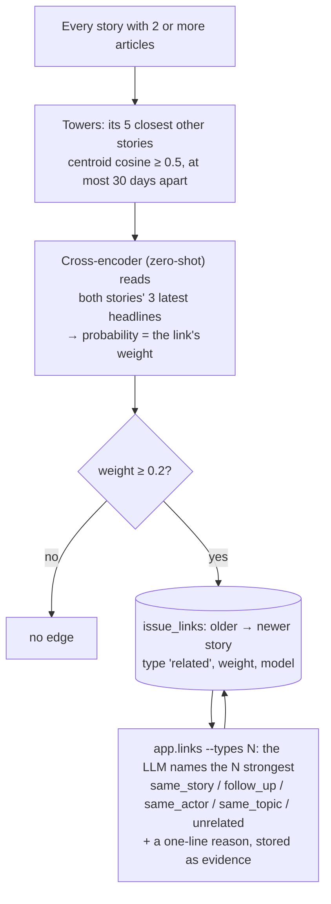

Full run (2026-10-20): the 14,782 stories with 2 or more articles gave 62,039 candidate pairs, and 10,390 links were kept. The LLM named the 500 strongest: same_topic 330, unrelated 70, same_story 66, same_actor 34, follow_up 0. The strongest links are mostly look-alikes (market updates, horoscopes): the weight comes from the cross-encoder before fine-tuning (`BAAI/bge-reranker-v2-m3`), which rates look-alikes high.

Walking the graph: a story's page (`GET /api/issues/{id}`) shows the stories linked to it in either direction, strongest first, up to 20, with links named `unrelated` hidden. Each one opens that story's page, with its own links, so you walk the graph one hop at a time. A multi-hop query (`WITH RECURSIVE` over `issue_links`) is planned.

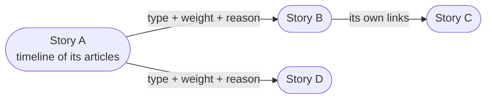

The tables:

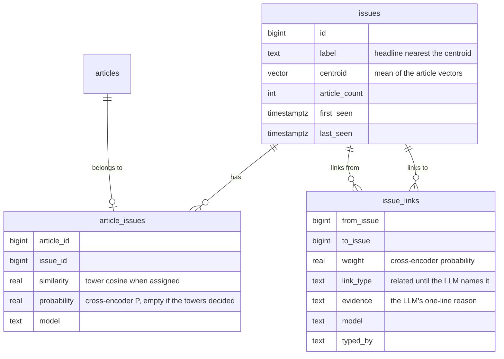

## 7. The decisions behind this (D-023 to D-029)

All taken 2026-10-20. Full text in [`DECISIONS.md`](DECISIONS.md).

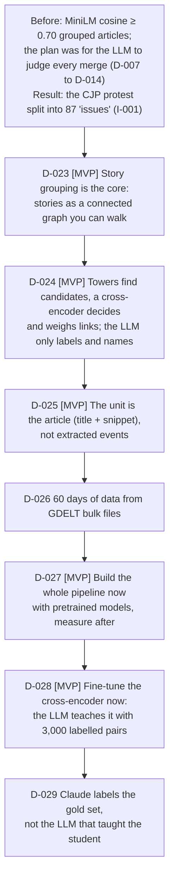
