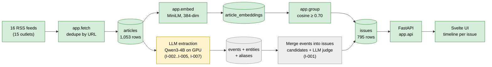
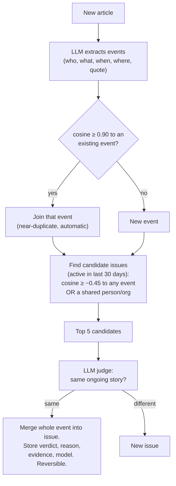

# Smriti: diagrams

_Last updated: 2026-10-20._ Where we stand in words: [`PROGRESS.md`](../PROGRESS.md). Problems: [`ISSUES.md`](ISSUES.md). Why things are the way they are: [`DECISIONS.md`](DECISIONS.md).

## 1. Pipeline

Green = built. Yellow = testing. Grey = designed, not built. Red = blocked.

## 2. Issue board

IDs link to [`ISSUES.md`](ISSUES.md). P1 issues are marked with ★.

```mermaid
flowchart LR
    subgraph OPEN["Open"]
        direction TB
        I007["★ I-007<br/>Ollama OOM-killed"]
        I005["I-005<br/>duplicate events"]
        I009["I-009<br/>data stale"]
        I011["I-011<br/>old NVIDIA package"]
        I012["I-012<br/>git credential warning"]
    end
    subgraph PROG["In progress"]
        direction TB
        I001["★ I-001<br/>event vs issue clusters"]
        I002["★ I-002<br/>who errors"]
        I003["I-003<br/>action_type"]
        I004["I-004<br/>speculation as fact"]
    end
    subgraph BLOCK["Blocked"]
        direction TB
        NONE["(none)"]
    end
    subgraph DONE["Closed"]
        direction TB
        I006["I-006 quotes"]
        I008["I-008 TECHNICAL.md"]
        I010["I-010 GDELT (won't fix)"]
        I013["I-013 Secure Boot"]
        I014["I-014 model too big"]
    end
    OPEN ~~~ PROG ~~~ BLOCK ~~~ DONE

    classDef p1 fill:#f8d7da,stroke:#c62828,color:#000
    classDef normal fill:#fff,stroke:#888,color:#000
    classDef closed fill:#d4edda,stroke:#2e7d32,color:#000
    class I007,I001,I002 p1
    class I005,I009,I011,I012,I003,I004,NONE normal
    class I006,I008,I010,I013,I014 closed
```

## 3. How a new article becomes part of an issue (designed, D-005 to D-015)

